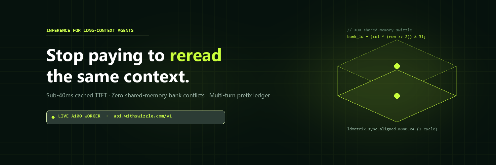

<a name="top"></a>

<div align="center">



<br>


# Swizzle Runtime (`swizzle-rt`)

### Exact, high-throughput Rust inference engine for GGUF & `.ktc` models

Written in pure Rust with custom x86-64 AVX2/F16C, NVIDIA CUDA (`sm_75`–`sm_120`), and cross-vendor Vulkan compute kernels. Runs on CPU, NVIDIA, AMD, and Intel GPUs from a single static binary — **with bit-for-bit identical output across every acceleration pass**.

[](LICENSE)
[](#server-and-apis)

**[Swizzle AI](https://github.com/Swizzle-AI)** &emsp; **[Architecture](docs/src/how-it-is-fast.md)** &emsp; **[Benchmarks](docs/src/benchmarks.md)**

</div>

---

## Overview

**Swizzle Runtime** (`swizzle-rt`) is Swizzle AI's local high-throughput inference runtime, engineered in Rust and CUDA/Vulkan.

Every speed-up preserves deterministic greedy output and reproducible inference receipts (`swizzle-rt verify-receipt`):

- **RAD-1 (Self-Speculative Decoding)**: Reuses the target model's own quantized weights or internal prediction blocks (`mtp`), verifying candidate branches in a single batched pass with exact acceptance/rejection.
- **Warm Start (Two-Tier Prefix Cache)**: Shares KV and recurrent DeltaNet/Mamba/ShortConv states in RAM and disk across turns and sessions.
- **Zero Wait (Async CUDA Overlap)**: Hides host–device dispatch overhead by overlapping CPU scheduling with GPU kernel submission via double-buffered CUDA graphs and event sync.
- **Shortlist (Exact Two-Stage Vocabulary Bound)**: Screens rare tokens with compact `Q4_K` bounds and exact row selection — without altering the winning token or top-k logprobs.
- **Swizzle-Tuned Kernels & Scheduler** *(engineered via incremental PRs #1–#4)*:
  - Swizzle XOR bank-conflict-free shared-memory GEMM tiling (`GemmTile`, `-9.1%` shared memory) + `SWIZZLE_CUDA_ARCH` / `nvcc` 12.8+ targeting
  - Zero-copy CPU Shortlist + CUDA GPU-resident Shortlist screening inside single CUDA graphs
  - Thread-local `SINGLE_WORKSPACE` quantization buffers, physical-core `for_each_decode` scheduling, and zero-dependency `FxHashMap` session lookup
  - Built-in `swizzle-rt bench` latency telemetry (`ttft_ms`, decode ITL `p50`/`p95`/`p99`) and HTTP telemetry headers (`X-Swizzle-Backend`, `X-Swizzle-TTFT-Ms`, `X-Swizzle-Tokens-Per-Sec`, `X-Swizzle-Gen-Tokens`, `X-Swizzle-Receipt-Hash`)

---

## Quick Start

### Build from Source

CPU + Vulkan (no CUDA toolkit required; CUDA driver opened dynamically when built with `nvcc`):

```sh
cargo build --release --locked -p kinetic-cli
```

CPU-only build:

```sh
cargo build --release --locked -p kinetic-cli --no-default-features
```

With CUDA support (requires `nvcc` 12.8+ for full `sm_75`..`sm_120` fatbins):

```sh
cargo build --release --locked -p kinetic-cli --features cuda
```

### Run, Chat, Serve, Benchmark

```sh
# Pull a GGUF model directly from Hugging Face
swizzle-rt pull LiquidAI/LFM3-1.7B-GGUF:Q4_K_M

# Single prompt with cryptographic execution receipt
swizzle-rt run path/to/model.gguf -p "Explain warp swizzling in CUDA shared memory." --receipt run.receipt.json

# Interactive terminal chat
swizzle-rt chat path/to/model.gguf

# Serve OpenAI (/v1/*), llama-server (/completion, /props), and Ollama (/api/*) APIs
swizzle-rt serve path/to/model.gguf --port 8080

# Built-in hardware micro-benchmarks & prefill/decode telemetry
swizzle-rt bench path/to/model.gguf --device cuda
```

---

## Server and APIs

`swizzle-rt serve` exposes a drop-in server compatible with:

- **OpenAI API**: `/v1/chat/completions`, `/v1/completions`, `/v1/models`, `/v1/embeddings`, `/v1/rerank`, `/health`
- **llama.cpp `llama-server` API**: `/completion`, `/tokenize`, `/detokenize`, `/props`, `/slots`
- **Ollama API**: `/api/chat`, `/api/generate`, `/api/tags`, `/api/ps`, `/api/show`, `/api/version`
- **Swizzle Ecosystem Integration**: Designed to sit directly behind [`swizzle-gateway`](https://github.com/Swizzle-AI/swizzle-gateway), [`swizzle-router`](https://github.com/Swizzle-AI/swizzle-router), and [`swizzle-python-sdk`](https://github.com/Swizzle-AI/swizzle-python-sdk).

---

## Verified Benchmarks

Measured back-to-back on an **AMD Ryzen 7 170** (16 logical / 8 physical cores) + **NVIDIA GeForce RTX 3050 Laptop GPU** (4 GB VRAM, `sm_86`, CUDA 12.8, driver 591.84) via `scripts/bench_compare_engines.py --repetitions 5 --cooldown-secs 5` (all runs verified `edit_identical: true` and 4/4 greedy `/v1/completions` output parity; peak GPU temp `56°C`):

| Model | Device | Test | Baseline (tok/s) | Swizzle Runtime (tok/s) | Delta | Swizzle Latency |
| --- | --- | --- | ---: | ---: | ---: | --- |
| `Qwen3-0.6B-Q8_0.gguf` | CUDA | `pp512` | 11550.31 | 11804.23 | +2.2% | TTFT 43.37 ms |
| `Qwen3-0.6B-Q8_0.gguf` | CUDA | `tg128` | 196.84 | 209.70 | +6.5% | ITL p50/p95/p99: 4.84 / 5.61 / 5.88 ms |
| `Qwen3-0.6B-Q8_0.gguf` | CUDA | `edit256` | 737.47 | 759.75 | +3.0% | `edit_identical: yes` |
| `Qwen3-0.6B-Q8_0.gguf` | CPU | `pp512` | 240.19 | 254.90 | +6.1% | TTFT 2008.61 ms |
| `Qwen3-0.6B-Q8_0.gguf` | CPU | `tg128` | 24.76 | 24.37 | -1.6% | ITL p50/p95/p99: 39.75 / 52.90 / 74.11 ms |
| `Qwen3-0.6B-Q8_0.gguf` | CPU | `edit256` | 65.80 | 90.61 | +37.7% | `edit_identical: yes` |
| `LFM3-1.7B-Q4_K_M.gguf` | CUDA | `pp512` | 5282.85 | 4985.19 | -5.6% | TTFT 102.70 ms |
| `LFM3-1.7B-Q4_K_M.gguf` | CUDA | `tg128` | 134.82 | 144.26 | +7.0% | ITL p50/p95/p99: 7.04 / 7.79 / 8.22 ms |
| `LFM3-1.7B-Q4_K_M.gguf` | CUDA | `edit256` | 650.17 | 656.55 | +1.0% | `edit_identical: yes` |
| `LFM3-1.7B-Q4_K_M.gguf` | CPU | `pp512` | 207.24 | 209.58 | +1.1% | TTFT 2442.95 ms |
| `LFM3-1.7B-Q4_K_M.gguf` | CPU | `tg128` | 16.15 | 18.06 | +11.8% | ITL p50/p95/p99: 55.85 / 79.38 / 97.39 ms |
| `LFM3-1.7B-Q4_K_M.gguf` | CPU | `edit256` | 83.87 | 82.25 | -1.9% | `edit_identical: yes` |

See [docs/src/benchmarks.md](docs/src/benchmarks.md) for methodology, latency percentiles, and reproduction instructions.

---

## License

Licensed under the [Apache License 2.0](LICENSE). Third-party material is listed in [NOTICE](NOTICE).
