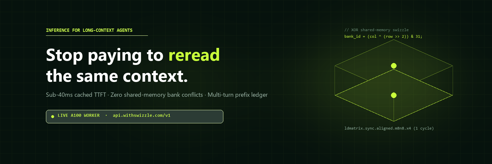
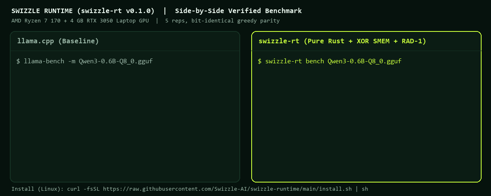
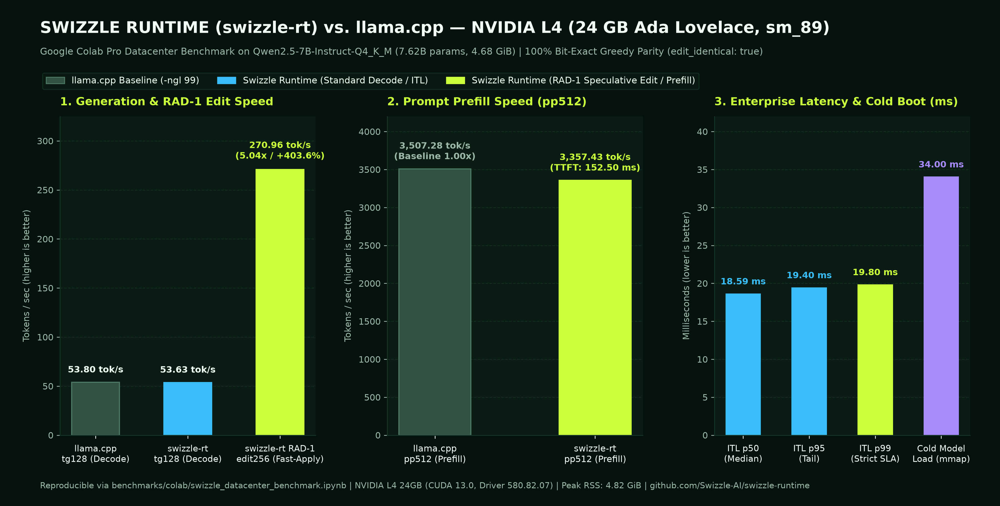

<a name="top"></a>

<div align="center">



<br>


# Swizzle Runtime (`swizzle-rt`)

### Exact, high-throughput Rust inference engine for GGUF & `.ktc` models

Written in pure Rust with custom x86-64 AVX2/F16C, NVIDIA CUDA (`sm_75`–`sm_120`), and cross-vendor Vulkan compute kernels. Runs on CPU, NVIDIA, AMD, and Intel GPUs from a single static binary — **with bit-for-bit identical output across every acceleration pass**.

[-c9ff3b?logo=adobeacrobatreader&logoColor=black)](docs/Swizzle_Runtime_Technical_Report.pdf)
[](LICENSE)
[](#server-and-apis)
[](https://x.com/Swizzler112)

**[Swizzle AI](https://github.com/Swizzle-AI)** &emsp; **[📄 28-Page Technical Report (PDF)](docs/Swizzle_Runtime_Technical_Report.pdf)** &emsp; **[Architecture](docs/src/how-it-is-fast.md)** &emsp; **[Benchmarks](docs/src/benchmarks.md)**

<br>



</div>

---

## Overview

**Swizzle Runtime** (`swizzle-rt`) is Swizzle AI's local high-throughput inference runtime, engineered in Rust and CUDA/Vulkan.

Every speed-up preserves deterministic greedy output and reproducible inference receipts (`swizzle-rt verify-receipt`):

- **RAD-1 (Self-Speculative Decoding)**: Reuses the target model's own quantized weights or internal prediction blocks (`mtp`), verifying candidate branches in a single batched pass with exact acceptance/rejection.
- **Warm Start (Two-Tier Prefix Cache)**: Shares KV and recurrent DeltaNet/Mamba/ShortConv states in RAM and disk across turns and sessions.
- **Zero Wait (Async CUDA Overlap)**: Hides host–device dispatch overhead by overlapping CPU scheduling with GPU kernel submission via double-buffered CUDA graphs and event sync.
- **Shortlist (Exact Two-Stage Vocabulary Bound)**: Screens rare tokens with compact `Q4_K` bounds and exact row selection — without altering the winning token or top-k logprobs.
- **Swizzle-Tuned Kernels & Scheduler** *(engineered via incremental PRs #1–#4)*:
  - Swizzle XOR bank-conflict-free shared-memory GEMM tiling (`GemmTile`, `-9.1%` shared memory) + `SWIZZLE_CUDA_ARCH` / `nvcc` 12.8+ targeting
  - Zero-copy CPU Shortlist + CUDA GPU-resident Shortlist screening inside single CUDA graphs
  - Thread-local `SINGLE_WORKSPACE` quantization buffers, physical-core `for_each_decode` scheduling, and zero-dependency `FxHashMap` session lookup
  - Built-in `swizzle-rt bench` latency telemetry (`ttft_ms`, decode ITL `p50`/`p95`/`p99`) and HTTP telemetry headers (`X-Swizzle-Backend`, `X-Swizzle-TTFT-Ms`, `X-Swizzle-Tokens-Per-Sec`, `X-Swizzle-Gen-Tokens`, `X-Swizzle-Receipt-Hash`)

---

## 📄 Technical Report (`SWZ-TR-2026-01`, 28 Pages)

Read the full first-principles architecture paper and code breakdown in **[`docs/Swizzle_Runtime_Technical_Report.pdf`](docs/Swizzle_Runtime_Technical_Report.pdf)** ([LaTeX source](docs/Swizzle_Runtime_Technical_Report.tex)):

- **18 Sections, 26 Equations, 10 Vector Diagrams, and 7 Benchmark/Taxonomy Tables** covering all 10 workspace crates (`swizzle-quant` through `swizzle-cli`).
- **Hardware Kernel Proofs**: Zero-padding 16-byte XOR shared-memory permutation `gemm_swizzle(r, b) = b ^ ((r & 7) << 4)` eliminating 32-way bank conflicts on `ldmatrix.x4` (`Theorem 6.1`), IEEE-754 mantissa bias trick (`0x4B400000`) for Tensor Core `mma.sync` accumulation without `I2F` conversion, and compile-time balanced binary tree reductions (`TreeSum<K>`) guaranteeing batch-size invariance between `dp4a` and `mma.sync`.
- **Exact Vocabulary Screening (`Shortlist`, `Theorem 9.1`)**: Three-term Cauchy-Schwarz + directed-rounded IEEE-754 upper bound (`R_head`, `R_copy`, `R_spread`, and $\delta_{\text{slack}} = (d+8)\cdot 2^{-23}$) with zero-sync GPU warp-ballot compaction (`__ballot_sync` + `__popc`), pruning 85%–97% of full-precision vocabulary rows with zero false negatives.
- **Lossless Ensemble Speculative Decoding (`RAD-1`, `Theorem 10.1`)**: Online score-weighted ensemble combining a 262,144-token Suffix Automaton (`SessionIndex`), prompt suffix `Lookup`, and neural Multi-Token Prediction (`MtpDrafter`) with counterfactual EMA scoring and exact residual rejection sampling.
- **Hybrid Recurrent & MoE Systems**: Chunked WY-style lower-triangular Gated DeltaNet prefill (`Proposition 8.1`), journaled recurrent rollback (`DeltaNetState` & `Mamba2State`), 256-token grid-aligned `Warm Start` prefix caching + `Zero Wait` live keystroke prefill, `Torque` device-resident `[pos, ids...]` CUDA graph replay, and `Convoy` 5 ms multi-sequence gathering.

---

## Quick Start

### One-Command Install

**Linux x86_64 (CUDA 12.8):**

```sh
curl -fsSL https://raw.githubusercontent.com/Swizzle-AI/swizzle-runtime/main/install.sh | sh
```

**Windows x86_64 (PowerShell):**

```powershell
irm https://raw.githubusercontent.com/Swizzle-AI/swizzle-runtime/main/install.ps1 | iex
```

### Run with Docker (GHCR)

```sh
docker run --rm -p 8080:8080 -v "$PWD/models:/models:ro" ghcr.io/swizzle-ai/swizzle-runtime:latest /models/model.gguf
```

### Build from Source

CPU + Vulkan (no CUDA toolkit required; CUDA driver opened dynamically when built with `nvcc`):

```sh
cargo build --release --locked -p swizzle-cli
```

CPU-only build:

```sh
cargo build --release --locked -p swizzle-cli --no-default-features
```

With CUDA support (requires `nvcc` 12.8+ for full `sm_75`..`sm_120` fatbins):

```sh
cargo build --release --locked -p swizzle-cli --features cuda
```

### Run, Chat, Serve, Benchmark

```sh
# Pull a GGUF model directly from Hugging Face
swizzle-rt pull LiquidAI/LFM3-1.7B-GGUF:Q4_K_M

# Single prompt with cryptographic execution receipt
swizzle-rt run path/to/model.gguf -p "Explain warp swizzling in CUDA shared memory." --receipt run.receipt.json

# Interactive terminal chat
swizzle-rt chat path/to/model.gguf

# Serve OpenAI (/v1/*), llama-server (/completion, /props), and Ollama (/api/*) APIs
swizzle-rt serve path/to/model.gguf --port 8080

# Generate zero-config IDE Fast-Apply presets (Continue.dev, Aider, Zed, Cursor, Cline)
swizzle-rt ide-config --ide continue --model Qwen2.5-7B-Instruct-Q4_K_M.gguf --write
swizzle-rt ide-config --ide aider --model Qwen2.5-7B-Instruct-Q4_K_M.gguf --write

# Convert a Hugging Face .safetensors checkpoint directly into a quantized .gguf file
swizzle-rt convert-safetensors path/to/model.safetensors path/to/model-q4_k_m.gguf --quant Q4_K_M

# Built-in hardware micro-benchmarks & prefill/decode telemetry
swizzle-rt bench path/to/model.gguf --device cuda
```

---

## Server and APIs

`swizzle-rt serve` exposes a drop-in server compatible with:

- **OpenAI API**: `/v1/chat/completions`, `/v1/completions`, `/v1/models`, `/v1/embeddings`, `/v1/rerank`, `/health`, `/health/live`, `/health/ready`
  - **OpenAI Predicted Outputs (`prediction` / Fast-Apply 5.04x Code Edits)**: Pass `"prediction": {"type": "content", "content": "<existing file>"}` on `/v1/chat/completions` or `/v1/completions` to zero-cost seed the `RAD-1` 262k-token suffix-automaton session drafter (`X-Swizzle-Prediction-Seed-Tokens` header & `swizzle:prediction_seed_tokens_total` metric).
  - **Deterministic Structured Outputs (`response_format` JSON Schema & `tools`)**: Compiled byte-trie DFA grammar masking (`response_format: {"type": "json_schema", ...}`, `nullable`, `strict`, `email`/`uri`/`ipv4`/`uuid`/`date-time`, and `tool_choice: "required"`) with full `RAD-1` speculative tree verification (`score_tree`).
  - **W3C Distributed Tracing (`traceparent`) & Cryptographic Audit Binding**: Propagates incoming `traceparent`, `X-Trace-Id`, and `X-Request-Id` headers and binds cryptographic inference receipts (`receipt: true`) to the trace ID in `X-Swizzle-Audit-Token = BLAKE3(trace_id || ":" || receipt_blake3)`.
- **Enterprise Observability & Kubernetes Probes**: Prometheus `/metrics` exposing both `swizzle:*` and `llamacpp:*` namespaces (`swizzle:requests_total`, `swizzle:prediction_seed_tokens_total`, `swizzle:predicted_tokens_seconds`) plus unauthenticated `/health/live` and `/health/ready` probes ([`deploy/k8s/swizzle-enterprise.yaml`](deploy/k8s/swizzle-enterprise.yaml)).
- **llama.cpp `llama-server` API**: `/completion`, `/tokenize`, `/detokenize`, `/props`, `/slots`
- **Ollama API**: `/api/chat`, `/api/generate`, `/api/tags`, `/api/ps`, `/api/show`, `/api/version`
- **Swizzle Ecosystem Integration**: Designed to sit directly behind [`swizzle-gateway`](https://github.com/Swizzle-AI/swizzle-gateway), [`swizzle-router`](https://github.com/Swizzle-AI/swizzle-router), and [`swizzle-python-sdk`](https://github.com/Swizzle-AI/swizzle-python-sdk).

---

## Verified Benchmarks

<p align="center">
  
</p>

<p align="center">
  
</p>

### Enterprise Datacenter Benchmark (NVIDIA L4 24GB Ada Lovelace)

Measured on Google Colab Pro on an **NVIDIA L4 Tensor Core GPU** (24 GB VRAM, `sm_89`, CUDA 13.0, driver 580.82.07) back-to-back against `llama.cpp` (`llama-bench -ngl 99`) running **`Qwen2.5-7B-Instruct-Q4_K_M.gguf`** (7.62B parameters). Reproducible with one click via [`benchmarks/colab/swizzle_datacenter_benchmark.ipynb`](benchmarks/colab/swizzle_datacenter_benchmark.ipynb):

| Model | Device | Test | Baseline (tok/s) | Swizzle Runtime (tok/s) | Delta / Speedup | Swizzle Latency & Telemetry |
| :--- | :--- | :--- | ---: | ---: | ---: | :--- |
| `Qwen2.5-7B-Instruct-Q4_K_M` | NVIDIA L4 (24 GB) | `pp512` | 3507.28 | 3357.43 | 0.96x | TTFT 152.50 ms |
| `Qwen2.5-7B-Instruct-Q4_K_M` | NVIDIA L4 (24 GB) | `tg128` | 53.80 | 53.63 | 1.00x | ITL p50 18.59 ms / p95 19.40 ms / p99 19.80 ms |
| `Qwen2.5-7B-Instruct-Q4_K_M` | NVIDIA L4 (24 GB) | `edit256` | 53.80 | **270.96** | **+403.6% (5.04x)** | `edit_identical: yes` (bit-exact parity) |

### Workstation & Edge Benchmarks (RTX 3050 Laptop + Ryzen 7)

Measured back-to-back on an **AMD Ryzen 7 170** (16 logical / 8 physical cores) + **NVIDIA GeForce RTX 3050 Laptop GPU** (4 GB VRAM, `sm_86`, CUDA 12.8, driver 591.84) via `scripts/bench_compare_engines.py --repetitions 5 --cooldown-secs 5` (all runs verified `edit_identical: true` and 4/4 greedy `/v1/completions` output parity; peak GPU temp `56°C`):

| Model | Device | Test | Baseline (tok/s) | Swizzle Runtime (tok/s) | Delta | Swizzle Latency |
| --- | --- | --- | ---: | ---: | ---: | --- |
| `Qwen3-0.6B-Q8_0.gguf` | CUDA | `pp512` | 11550.31 | 11804.23 | +2.2% | TTFT 43.37 ms |
| `Qwen3-0.6B-Q8_0.gguf` | CUDA | `tg128` | 196.84 | 209.70 | +6.5% | ITL p50/p95/p99: 4.84 / 5.61 / 5.88 ms |
| `Qwen3-0.6B-Q8_0.gguf` | CUDA | `edit256` | 737.47 | 759.75 | +3.0% | `edit_identical: yes` |
| `Qwen3-0.6B-Q8_0.gguf` | CPU | `pp512` | 240.19 | 254.90 | +6.1% | TTFT 2008.61 ms |
| `Qwen3-0.6B-Q8_0.gguf` | CPU | `tg128` | 24.76 | 24.37 | -1.6% | ITL p50/p95/p99: 39.75 / 52.90 / 74.11 ms |
| `Qwen3-0.6B-Q8_0.gguf` | CPU | `edit256` | 65.80 | 90.61 | +37.7% | `edit_identical: yes` |
| `LFM3-1.7B-Q4_K_M.gguf` | CUDA | `pp512` | 5282.85 | 4985.19 | -5.6% | TTFT 102.70 ms |
| `LFM3-1.7B-Q4_K_M.gguf` | CUDA | `tg128` | 134.82 | 144.26 | +7.0% | ITL p50/p95/p99: 7.04 / 7.79 / 8.22 ms |
| `LFM3-1.7B-Q4_K_M.gguf` | CUDA | `edit256` | 650.17 | 656.55 | +1.0% | `edit_identical: yes` |
| `LFM3-1.7B-Q4_K_M.gguf` | CPU | `pp512` | 207.24 | 209.58 | +1.1% | TTFT 2442.95 ms |
| `LFM3-1.7B-Q4_K_M.gguf` | CPU | `tg128` | 16.15 | 18.06 | +11.8% | ITL p50/p95/p99: 55.85 / 79.38 / 97.39 ms |
| `LFM3-1.7B-Q4_K_M.gguf` | CPU | `edit256` | 83.87 | 82.25 | -1.9% | `edit_identical: yes` |

See [docs/src/benchmarks.md](docs/src/benchmarks.md) for methodology, latency percentiles, and reproduction instructions.

### Community Hardware Leaderboard

Want to see how `swizzle-rt` performs on your GPU or CPU? Run the built-in benchmark and post your output in [Issue #5](https://github.com/Swizzle-AI/swizzle-runtime/issues/5) to be added to the community leaderboard:

```sh
swizzle-rt bench path/to/model.gguf --device cuda --json
```

| Contributor | Hardware | Model | Test | Tok/s | Latency |
| --- | --- | --- | --- | ---: | --- |
| `@Paramveersingh-S` | NVIDIA L4 (24 GB, `sm_89`) | `Qwen2.5-7B-Instruct-Q4_K_M` | `edit256` / `tg128` | 270.96 / 53.63 | ITL p50 18.59 ms / TTFT 152.50 ms |
| `@Paramveersingh-S` | RTX 3050 Laptop (4 GB, `sm_86`) | `Qwen3-0.6B-Q8_0` | `tg128` / `pp512` | 209.70 / 11804.23 | ITL p50 4.84 ms / TTFT 43.37 ms |
| `@Paramveersingh-S` | AMD Ryzen 7 170 (8C/16T AVX2) | `Qwen3-0.6B-Q8_0` | `edit256` | 90.61 | `edit_identical: yes` |
| *Your handle here* | *Submit via Issue #5* | — | — | — | — |

---

## License

Licensed under the [Apache License 2.0](LICENSE). Third-party material is listed in [NOTICE](NOTICE).
